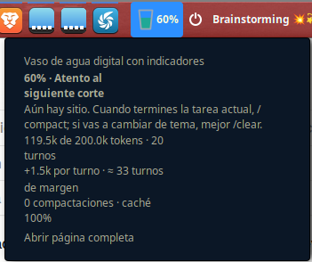

# Vaso de contexto

> Un vaso de agua que se llena a medida que tu sesión de Claude Code ocupa contexto, y te avisa de cuándo conviene `/compact`, `/clear` o empezar sesión nueva.

*English: a local context meter for Claude Code sessions. The Cinnamon applet has its own [English README](cinnamon/README.md).*



## Qué hace

El contexto de una conversación con un modelo de IA tiene tamaño máximo, y su llenado es invisible. Esto lo hace visible:

- **Página local** con un vaso que sube de nivel, los datos clave (tokens, turnos, crecimiento por turno, compactaciones) y un consejo claro.
- **Applet de panel** para Linux Mint Cinnamon: el vaso y el porcentaje siempre a la vista, con aviso al cruzar un umbral.
- **Consejo con IA** (opcional): con tu propia API key gratuita de Gemini, Groq u OpenRouter.

| Nivel del vaso | Consejo |
|---|---|
| menos del 50 % | Sigue tranquilo |
| 50 % | Atento al siguiente corte |
| 70 % | Haz /compact ahora |
| 85 % | Sesión nueva o /clear |

## Uso

Solo hace falta Python 3.9 o superior y haber usado Claude Code alguna vez. No se instala ningún paquete.

```bash
git clone https://github.com/D4vRAM369/vaso-de-contexto.git
cd vaso-de-contexto
python3 vaso.py
```

En Windows, `python vaso.py`. Se abre `http://127.0.0.1:8765` en el navegador.

| Qué | Cómo |
|---|---|
| No abrir el navegador | `python3 vaso.py --no-browser` |
| Estado en JSON por la terminal | `python3 vaso.py --json` |
| Autocomprobación | `python3 vaso.py --test` → imprime `ok` |
| Otro puerto | variable de entorno `VASO_PORT` |
| Sesiones fuera de `~/.claude` | variable de entorno `CLAUDE_CONFIG_DIR` |

## Applet de Cinnamon

Desde la carpeta del proyecto:

```bash
ln -sfn "$PWD/cinnamon/vaso-contexto@d4vram" ~/.local/share/cinnamon/applets/vaso-contexto@d4vram
```

Después: clic derecho en el panel → **Applets** → **Gestionar** → "Vaso de contexto" → **+**.

La versión de Cinnamon Spices no incluye el consejo con IA (su paquete no hace conexiones externas). Está enviada ([linuxmint/cinnamon-spices-applets#9116](https://github.com/linuxmint/cinnamon-spices-applets/pull/9116)); cuando se acepte, se podrá instalar desde la pestaña **Descargar**.

## Privacidad

- Todo se ejecuta en tu equipo. El servidor escucha solo en `127.0.0.1`.
- Lee los transcripts que Claude Code ya guarda en `~/.claude/projects` y de ellos saca recuentos de tokens y el título de la sesión.
- Nada sale de tu equipo salvo que pulses el botón de consejo con IA: entonces se envían las métricas y tus últimos mensajes al proveedor que hayas elegido, con tu key. La key se guarda en el navegador, no en el servidor.

## Documentación

[`docs/`](docs/README.md) explica cómo está construido paso a paso y desde cero, pensado para quien está aprendiendo a programar: glosario, arquitectura y decisiones, errores reales y cómo se resolvieron.

## Licencia

[MIT](LICENSE)
